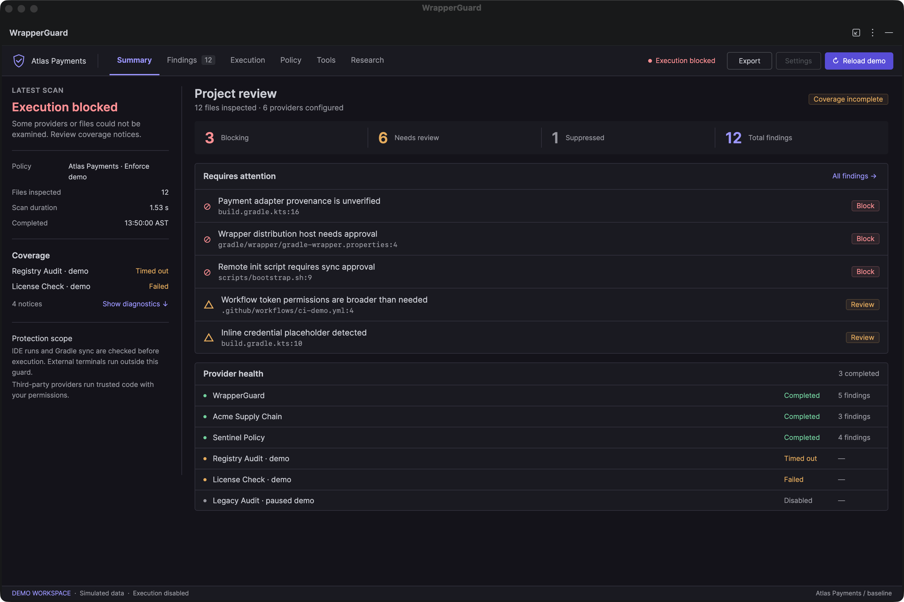
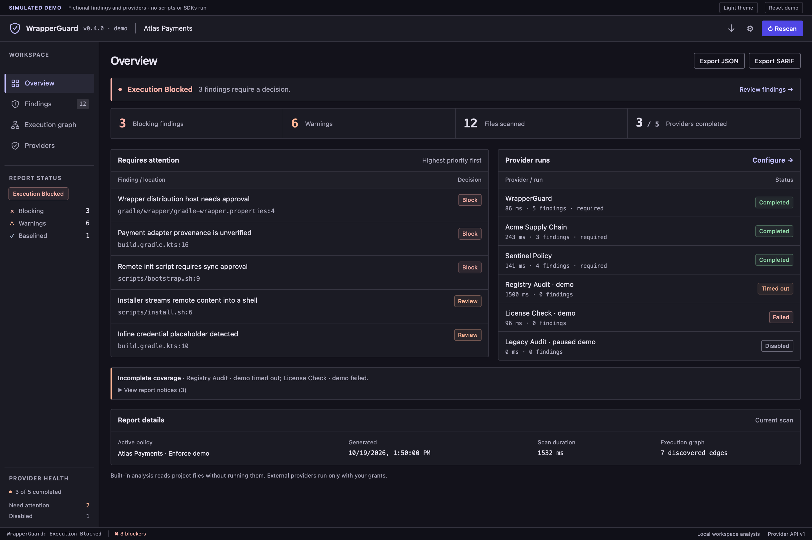
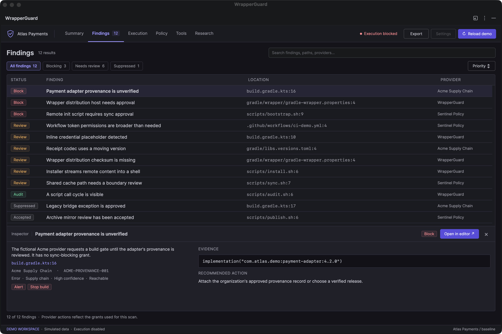
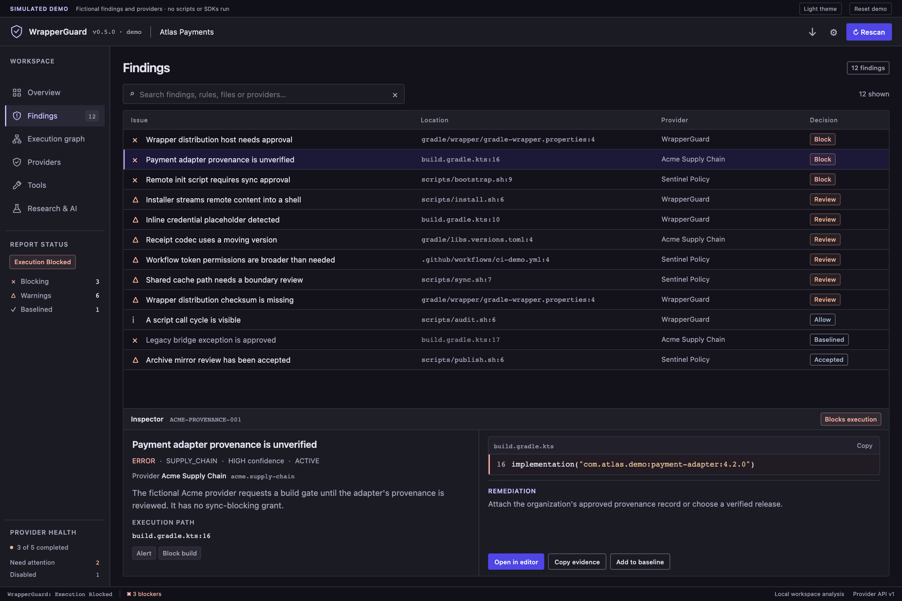
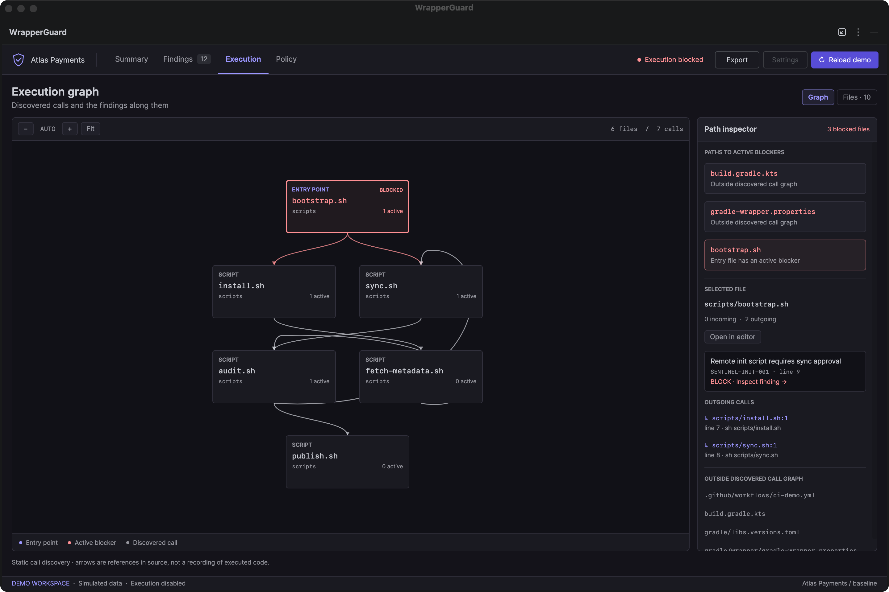
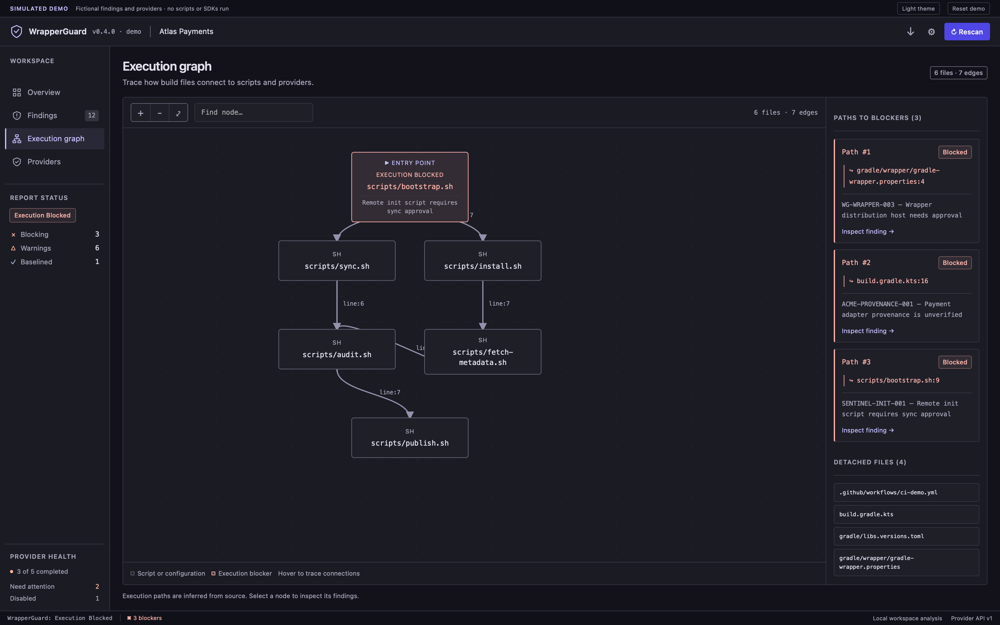
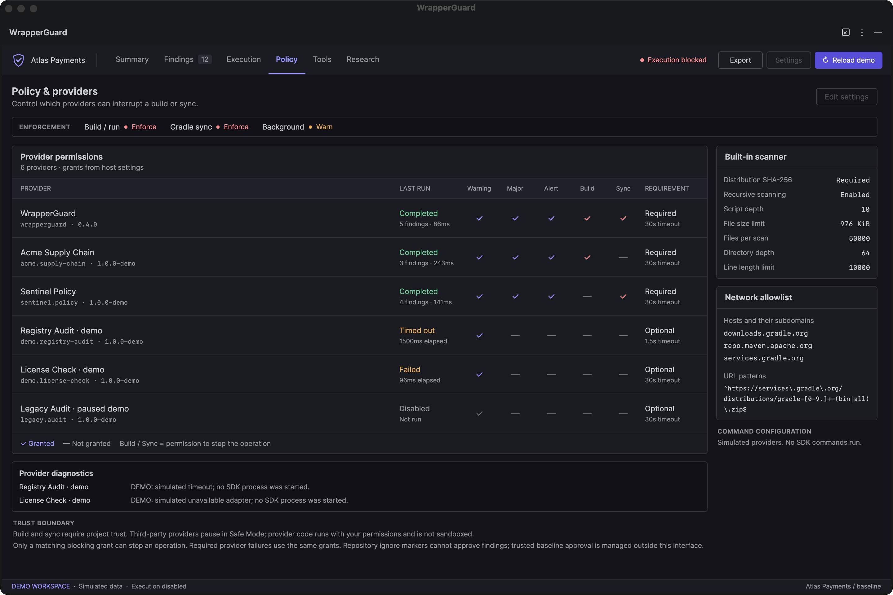
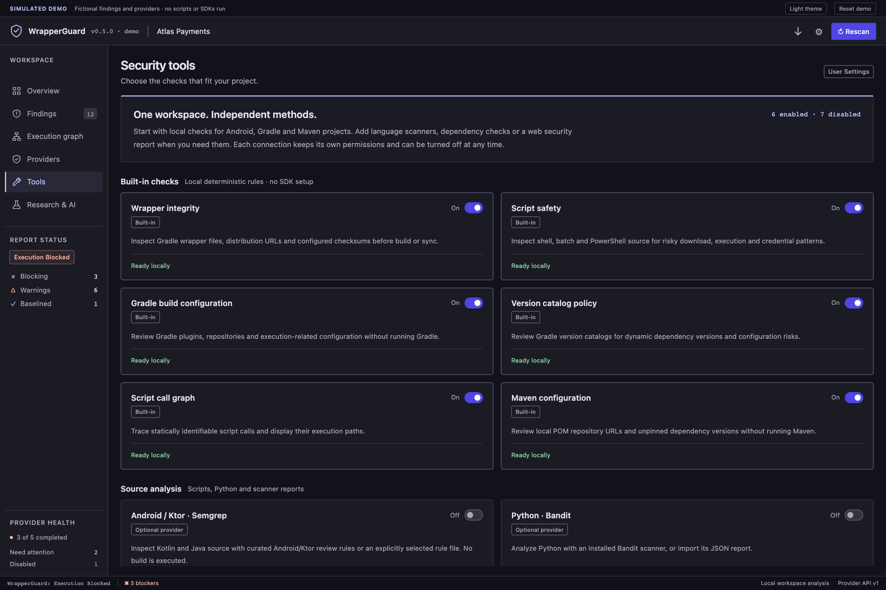
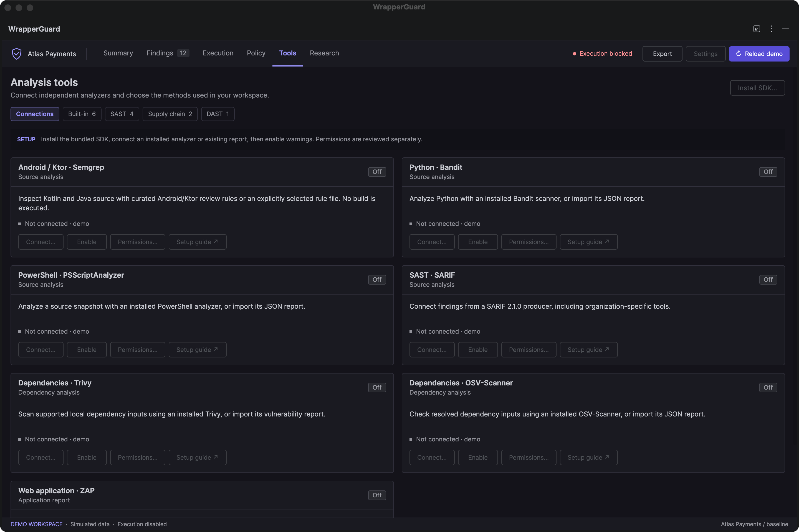
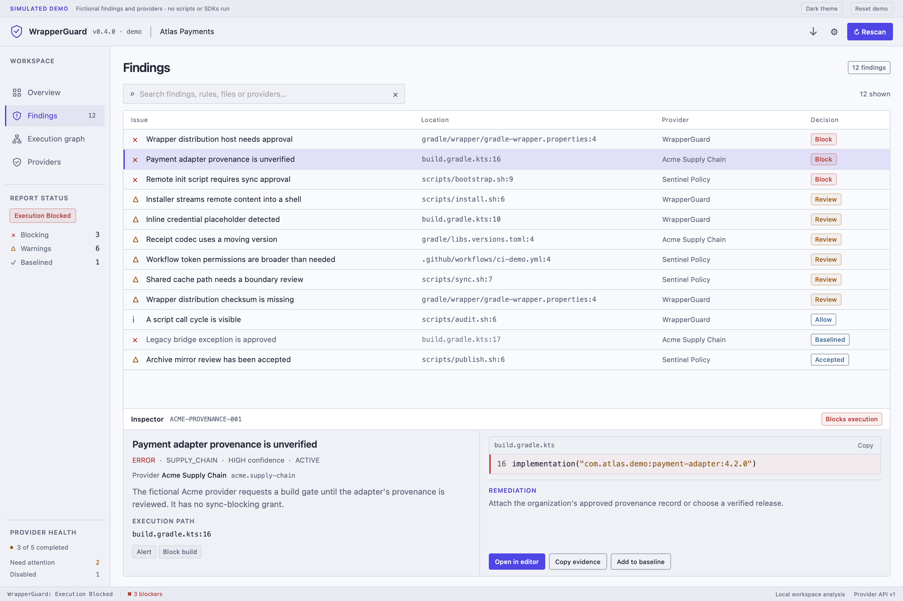

<p align="center">
  
</p>

<p align="center">
  <a href="https://github.com/Sal7one/NewWrapperGaurd/releases/tag/v0.7.0-rc.2"></a>
  <a href="LICENSE"></a>
  <a href="catalog/security-methods.json"></a>
  <a href="sdk/python/README.md"></a>
</p>

<p align="center">
  A security vetting workspace for <strong>Android Studio, IntelliJ IDEA, VS Code and CI.</strong><br />
  Bring your analyzers. Review findings together. Decide which providers can warn or block.
</p>

<p align="center">
  <a href="#install"><strong>Download &amp; install</strong></a> ·
  <a href="#screenshots">Screenshots</a> ·
  <a href="#security-methods">Security methods</a> ·
  <a href="docs/providers.md">Provider API</a> ·
  <a href="docs/roadmap.md">Roadmap</a>
</p>

---

WrapperGuard brings source checks, dependency findings, script execution paths and provider
permissions into the editor. Keep the original static checks, connect existing scanners, or
add your own SDK through the shared provider interface.

- **Make it yours.** Enable, disable, replace or remove analyzers independently.
- **Control authority.** Review each provider's warning, alert, build and sync permissions.
- **See the evidence.** Inspect findings, source locations, execution paths and coverage notices.
- **Keep scans useful.** Opt into history, compare compatible runs and detect stale inputs.
- **Automate deliberately.** Review change/interval triggers and use explicit Start/Pause controls.
- **Stay portable.** Use native IDEs, VS Code, CLI/CI and tested Windows scanner integrations.

**Current release: 0.7.0-rc.2 · SDK: 0.4.0 · Provider API/schema: 1.**
This is an early-access release candidate, distributed as manual installers. External
analyzers require separate setup; research and AI methods are optional and advisory.

## Screenshots

Native IDE captures and the compiled VS Code webview renderer, using **fictional Atlas Payments
demo data**. These images retain their original **0.5.0 gallery checkpoint**; findings, provider
names and timings are simulated. Click a screenshot to view it at full resolution.

<table>
  <tr>
    <td width="50%" valign="top">
      <a href="demo/screenshots/intellij/01-summary-dark.png"></a>
      <br /><strong>Native IDE · Project overview</strong><br />Findings, blockers and provider health in one view.
    </td>
    <td width="50%" valign="top">
      <a href="demo/screenshots/vscode/01-overview-dark.png"></a>
      <br /><strong>VS Code · Workspace overview</strong><br />The same provider model inside the editor.
    </td>
  </tr>
  <tr>
    <td width="50%" valign="top">
      <a href="demo/screenshots/intellij/02-findings-dark.png"></a>
      <br /><strong>Native IDE · Findings &amp; evidence</strong><br />Trace a finding to its provider, source and requested action.
    </td>
    <td width="50%" valign="top">
      <a href="demo/screenshots/vscode/02-findings-dark.png"></a>
      <br /><strong>VS Code · Finding inspector</strong><br />Review context and navigate to the relevant source.
    </td>
  </tr>
  <tr>
    <td width="50%" valign="top">
      <a href="demo/screenshots/intellij/03-execution-dark.png"></a>
      <br /><strong>Native IDE · Execution graph</strong><br />Explore statically identified script relationships.
    </td>
    <td width="50%" valign="top">
      <a href="demo/screenshots/vscode/09-execution-expanded.png"></a>
      <br /><strong>VS Code · Expanded execution paths</strong><br />Inspect connected files and findings along a path.
    </td>
  </tr>
  <tr>
    <td width="50%" valign="top">
      <a href="demo/screenshots/intellij/04-policy-dark.png"></a>
      <br /><strong>Native IDE · Provider permissions</strong><br />Choose which actions each analyzer may request.
    </td>
    <td width="50%" valign="top">
      <a href="demo/screenshots/vscode/10-tools-dark.png"></a>
      <br /><strong>VS Code · Optional methods</strong><br />Connect the tools that fit your project.
    </td>
  </tr>
  <tr>
    <td width="50%" valign="top">
      <a href="demo/screenshots/intellij/05-tools-dark.png"></a>
      <br /><strong>Native IDE · Analyzer connections</strong><br />Keep source, supply-chain and report integrations together.
    </td>
    <td width="50%" valign="top">
      <a href="demo/screenshots/vscode/05-findings-light.png"></a>
      <br /><strong>VS Code · Light theme</strong><br />Review the same findings in a lighter workspace.
    </td>
  </tr>
</table>

[Full screenshot gallery](demo/index.html) · [Demo data and reproduction](demo/README.md) ·
[Actual installed-host evidence](docs/verification.md#merged-master-rc2-acceptance)

## Install

Download the [0.7.0 RC2 release](https://github.com/Sal7one/NewWrapperGaurd/releases/tag/v0.7.0-rc.2).
There is no Marketplace or PyPI installation channel yet.

| Where you work | Download | Install |
|---|---|---|
| **Android Studio / IntelliJ** | [Native plugin ZIP](https://github.com/Sal7one/NewWrapperGaurd/releases/download/v0.7.0-rc.2/wrapperguard-intellij-0.7.0.zip) | Settings → Plugins → gear → **Install Plugin from Disk**; select the ZIP and restart. Minimum platform: IntelliJ 2025.2 / 252. |
| **VS Code** | [VSIX extension](https://github.com/Sal7one/NewWrapperGaurd/releases/download/v0.7.0-rc.2/wrapperguard-0.7.0.vsix) | Extensions → **… → Install from VSIX**; select the file and reload. Minimum VS Code: 1.95.0. |
| **Terminal / CI** | [CLI ZIP](https://github.com/Sal7one/NewWrapperGaurd/releases/download/v0.7.0-rc.2/wrapperguard-cli-0.7.0.zip) | Extract and run `bin/wrapperguard-cli` inside the distribution. Requires JDK 21. Windows: `bin/wrapperguard-cli.bat`. |
| **Python integrations** | [SDK wheel](https://github.com/Sal7one/NewWrapperGaurd/releases/download/v0.7.0-rc.2/wrapperguard_sdk-0.4.0-py3-none-any.whl) | Use the IDE's managed SDK setup or install the wheel into a dedicated Python 3.10+ environment. |

For a complete walkthrough, download the [test bundle](https://github.com/Sal7one/NewWrapperGaurd/releases/download/v0.7.0-rc.2/WrapperGuard-0.7.0-rc.2-test-bundle.zip).
Verify individual downloads against [ASSET-SHA256SUMS.txt](https://github.com/Sal7one/NewWrapperGaurd/releases/download/v0.7.0-rc.2/ASSET-SHA256SUMS.txt).
The bundle includes installation guides, inert fixtures and a packaged CLI gate check.

### Your first scan

1. **Open a project and WrapperGuard.** The six built-in static groups start enabled.
2. **Choose your methods.** Open **Tools** and select Built-in, SAST, Supply chain or DAST.
3. **Connect an analyzer or report.** Install the bundled SDK offline using a trusted Python
   3.10+ executable. Scanner downloads and model setup are separate, explicit choices.
4. **Review permissions, then enable and scan.** Native setup saves a connection disabled;
   VS Code's reviewed **Connect and run** action explicitly enables and scans.
5. **Inspect findings and coverage.** Follow source locations, review provider failures and
   rescan after changes. Opt into history or automation when you want them.

[Connection setup](docs/integrations.md) explains custom commands, multi-root projects,
maintenance, automation and presets. Try [the source-analysis walkthrough](docs/verification.md#ten-minute-source-analysis-check)
for a repeatable first test.

## Security methods

The [shared catalog](catalog/security-methods.json) defines **19 configurable methods**.
Six built-in groups start on; external analyzers, research and AI start off.

| Category | Available methods |
|---|---|
| **Built-in** | Gradle wrapper integrity, script safety, Gradle configuration, version catalogs, script call graph and Maven POM checks. |
| **SAST** | Semgrep for targeted Kotlin/Java/Android/Ktor checks; Bandit for Python; PSScriptAnalyzer for PowerShell; SARIF and Sonar generic issue imports. |
| **Supply chain** | Trivy and OSV-Scanner over supported dependency manifests/locks, or report imports; CycloneDX vulnerability-assessment imports. |
| **DAST** | Scoped ZAP report imports and optional bounded HTTP header/cookie checks against explicitly owned targets. |
| **Research** | Advisory Python/PowerShell behavior signals and optional selected-entry Python observations in a reviewed container. |
| **AI** | Advisory finding explanations from a separately configured local model. No model is bundled. |

Dependency coverage depends on the selected scanner and available resolved versions.
Unresolved dependencies and incomplete scope stay visible. This release does not include
general AAR/JAR decompilation or comprehensive npm-package behavior vetting.

## One interface, independent analyzers

Providers own detection logic. WrapperGuard coordinates execution and controls how their
findings affect the developer workflow.

| Capability | What you control |
|---|---|
| **Bring your own SDK** | Add a command adapter or VS Code integration using [Provider API 1](docs/providers.md), with custom categories, tags and declared inputs. |
| **Independent permissions** | Review warning, major-warning, alert, build-blocking and sync-blocking grants per provider. Host policy limits requested actions. |
| **Concurrent providers** | Combine results with deadlines, cancellation, attribution and visible failure/coverage notices. |
| **History and freshness** | Opt into bounded history, compare compatible scopes and track report/input provenance and stale results. |
| **Presets and automation** | Share reviewed method-flag presets. Configure change/interval SCAN triggers with explicit session Start/Pause. |
| **Maintenance** | Install/repair the SDK offline, explicitly update selected tools and remove only unused owned environments. |
| **Optional isolation** | Use supported Bandit/Semgrep and selected-entry Python research workflows with a reviewed local Docker engine and pinned image. |
| **Portable reports** | Export combined JSON/SARIF reports and use the CLI in CI. |

Custom providers do not have to use the bundled Python SDK. Integrate your own language,
scanner or organization-specific analyzer through the same contract.

### Use the CLI in CI

After extracting the CLI distribution, run its launcher against the project you intend to inspect:

```sh
./wrapperguard-cli-0.7.0/bin/wrapperguard-cli /absolute/project --json --enforce

./wrapperguard-cli-0.7.0/bin/wrapperguard-cli /absolute/project \
  --providers /absolute/user/providers.json \
  --operation build --enforce --json
```

Exit codes: **0** completed scope without blockers · **2** active granted blockers ·
**1** invalid/incomplete input without blockers. Select provider, method and baseline
configuration explicitly from user-owned files outside the scanned project.

[CI examples](examples/ci/README.md) · [Integration recipes](examples/integrations/README.md) ·
[Python SDK](sdk/python/README.md)

## Scope and trust

- **Build gates have defined boundaries.** Android Studio/IntelliJ guard supported IDE
  launches and Gradle sync. VS Code/CI integrations must call and honor their gates;
  arbitrary terminal commands are not intercepted.
- **Optional tools need setup and trust.** Installed analyzers run as OS-user code unless a
  supported container backend is explicitly selected. Action permissions are not an OS sandbox.
- **Network behavior is method-specific.** Built-in static checks are local; OSV can send
  dependency names/versions, Trivy can download databases, and HTTP audit sends reviewed
  requests. Local AI uses an explicitly configured loopback endpoint.
- **Coverage stays honest.** Failed, partial, stale, disabled or unsupported analysis cannot
  establish complete coverage. Research, local AI and HTTP auditing retain their documented
  experimental/limited scope. A passing configured scan does not prove an application secure.

[Integration coverage and trust](docs/integrations.md#coverage-and-trust) ·
[Security reporting](SECURITY.md) · [Remaining roadmap](docs/roadmap.md)

## Build from source

Use **JDK 21, Node 22+ and Python 3.10+ with pip**. From the repository root:

```sh
./gradlew build :wrapperguard-cli:installDist :wrapperguard-intellij:buildPlugin
./gradlew :wrapperguard-intellij:verifyPlugin

npm --prefix vscode-extension ci
npm --prefix vscode-extension test
npm --prefix vscode-extension run parity
npm --prefix vscode-extension run hardening
npm --prefix vscode-extension run package
```

Native release compilation defaults to IntelliJ **2025.2 / platform 252**. A development
IDE can be selected with `-Pwrapperguard.localIdePath=/path/to/IDE/Contents`.
The host matrix separately checks 2025.2, 2026.2.2 and 2026.2.3.
[Full verification instructions](docs/verification.md) cover SDK packaging, scanner smoke
tests, target-specific native tests and distribution audits.

<details>
<summary><strong>Release validation and repository layout</strong></summary>

The RC2 build passed all eight recorded workflows, including **234 JVM cases**, **48 real
VS Code host cases** and **18 native descriptor/component cases** across three IDE targets.
All three native binary verifiers were compatible. Actual Studio and Android emulator
evidence retain their original source identities and narrower scopes; component tests do
not replace full project-lifecycle testing on every newer IDE.

The release includes checksums, a runtime SBOM, build provenance and an acceptance archive.
[Verification](docs/verification.md) and [the release manifest](https://github.com/Sal7one/NewWrapperGaurd/releases/download/v0.7.0-rc.2/RELEASE-MANIFEST.json)
record actual results and remaining acceptance work.

| Location | Responsibility |
|---|---|
| `wrapperguard-core/` | Models, policy, provider coordination, grants and exports |
| `wrapperguard-rules/` | Static rules and bounded script traversal |
| `wrapperguard-cli/` | Terminal and CI host |
| `wrapperguard-intellij/` | Native workspace, guided setup and IDE gates |
| `vscode-extension/` | TypeScript host, webview and integration API |
| `sdk/python/` | Controlled runners, report adapters, research and local AI review |
| `catalog/` and `schema/` | Shared method definitions and integration contracts |
| `test-fixtures/` and `demo/` | Inert test inputs and clearly labeled fictional interface data |

</details>

## Contribute

Bug reports, focused fixes, scanner adapters, rules and documentation improvements are welcome.
Start with the [roadmap](docs/roadmap.md) or [open an issue](https://github.com/Sal7one/NewWrapperGaurd/issues).
For a new analyzer, read the [provider contract](docs/providers.md) and keep its setup,
permissions and removal independent of other methods. Include relevant validation with changes.

Report vulnerabilities through the private route described in [SECURITY.md](SECURITY.md).
Avoid posting credentials, confidential source or private analysis reports in public issues.

## Documentation

[Setup & integrations](docs/integrations.md) · [Provider API](docs/providers.md) ·
[Build & testing](docs/verification.md) · [Research & limitations](docs/research.md) ·
[Product references](docs/product-inspiration.md) · [Changelog](CHANGELOG.md) ·
[Engineering handover](HANDOVER.md)

## License

WrapperGuard and its first-party Python SDK are licensed under **[Apache-2.0](LICENSE)**.
Bundled dependencies retain their [third-party notices](THIRD_PARTY_NOTICES.md).
Separately installed analyzers, images and models retain their own licenses.
