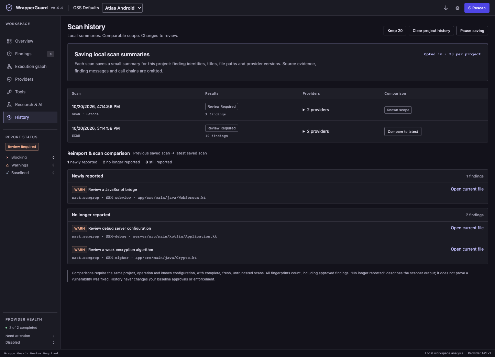

# WrapperGuard 0.6 platform screens

The groups below record actual IDE acceptance and explicitly synthetic demo views. [manifest.json](manifest.json) records their provenance and validation.

## Actual IntelliJ IDEA acceptance

These captures use the packaged 0.6.0 plugin in a normal cached IntelliJ IDEA 2025.3 runtime with isolated configuration, plugin storage and a disposable Gradle project. Demo and unit-test modes were off. The ZIP was extracted into that isolated plugin directory; this does not claim Marketplace or Android Studio installation coverage. The extracted macOS launcher was terminated by the host, so the IDE was bootstrapped through its declared JVM/classpath without `runIde`.

A process-locked test UI agent activated the actual Swing **Trust Project** and **Cancel** buttons and the IDE's **Run** action. It did not invoke scanner or guard internals or override trust settings. A harmless local Gradle task wrote a marker in the disposable project. A hazardous static wrapper fixture was inspected but never executed: the IDE used an installed local Gradle distribution.

| Capture | Actual result |
| --- | --- |
| [Blocked Gradle sync](intellij/sync-blocked.png) | Real startup import stopped with WrapperGuard's fixed host message before the Gradle configuration marker was created. |
| [Blocked build decision](intellij/build-blocked-dialog.png) | The actual before-run dialog displayed `WG-SCRIPT-001`; choosing Cancel left task and configuration markers absent. Restoring the harmless wrapper allowed the real Gradle task to create both markers. |
| [Analysis tools](intellij/tools.png) | Actual optional-tool connections, setup, method presets and managed storage controls; no synthetic provider findings. |
| [History opt-in](intellij/history-opt-in.png) | Actual default-off local history and its privacy/retention controls, before enabling recording. |

[Host evidence and scope](intellij/acceptance-evidence.txt). The actual-host run found and corrected the missing before-run extension registration and worker-thread dialog creation; focused registry and EDT regressions cover both. Android Studio, other IDE releases and a formal assistive-technology audit remain separate acceptance work. The provider builder's horizontal alignment was corrected after capture; a clipped pre-correction capture is intentionally excluded from this gallery.

## Actual VS Code acceptance

These captures show the installed VS Code extension development host with an isolated temporary profile and a controlled Android/Ktor fixture. The SDK wizard, literal argument editor, executable picker, permissions and save action were exercised through the actual interface. Saving a disabled connection did not execute it. Explicitly enabling it ran a controlled Provider API v1 Node adapter; its literal argument retained spaces. Selecting the sibling project paused that bound provider. History was explicitly enabled, then two real scans were saved and compared.

The adapter tests the integration protocol; it does not represent a third-party security analysis tool. No personal VS Code profile was used. [Native validation](native/validation.json).

| Capture | What it demonstrates |
| --- | --- |
| [SDK builder](native/sdk-builder.png) | Identity, executable, arguments, labels, read set, project binding and permissions in the real QuickPick wizard. |
| [Literal arguments](native/sdk-argv.png) | Separate argv entries preserve spaces without shell splitting. |
| [Default permissions](native/sdk-permissions.png) | A new custom connection starts disabled, optional and warning-only. |
| [Saved disabled connection](native/sdk-saved-disabled.png) | The connection is present before any adapter invocation. |
| [Connected provider](native/sdk-connected.png) | The controlled adapter completed after explicit enable. |
| [Another project](native/sdk-bound-other-project.png) | A project binding prevents invocation for the sibling root. |
| [Actual history](native/history.png) | Opt-in local history and comparison for real fixture scans. |

## Synthetic demo views

These are **DEMO data** rendered by the real webview. Atlas project names, company providers, finding counts and history changes are synthetic. They demonstrate layout, labels, keyboard interaction and responsive behavior; they are not security results. [Browser validation](demo/validation.json).

| View | Desktop | Narrow layout |
| --- | --- | --- |
| Custom SDK cards | [Desktop](demo/custom-sdk-desktop.png) | [Narrow](demo/custom-sdk-mobile.png) |
| Demo history differences | [Desktop](demo/history-desktop.png) | [Narrow](demo/history-mobile.png) |
| Tool and preset selection | [Desktop](demo/tools-desktop.png) | [Narrow](demo/tools-mobile.png) |

Validation at this source checkpoint: 122 Node tests, embedded webview checks and five scanner hardening checks passed. Browser checks covered Tab order, Enter activation, labelled project and provider controls, disabled scanning states and horizontal overflow. This is keyboard and label sanity checking, not a formal screen-reader audit.
