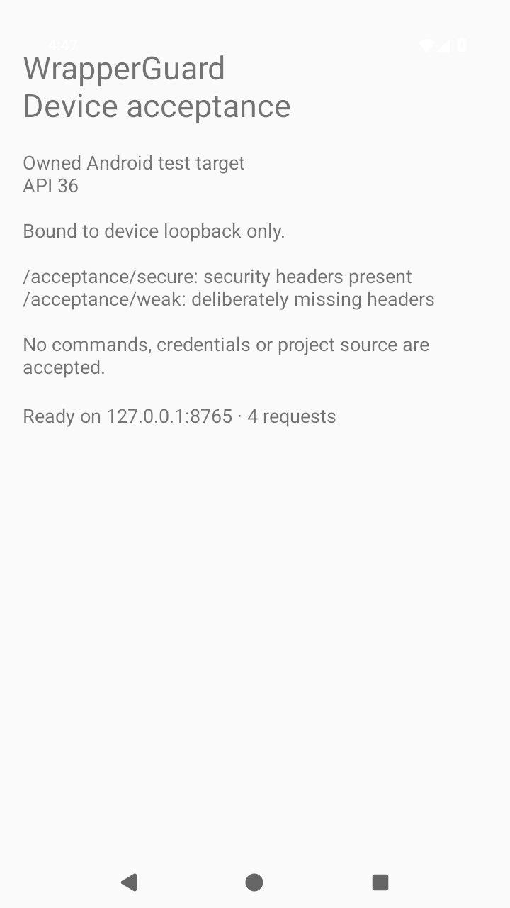

# Accepted Android emulator fixture

[Run 39459625818](https://github.com/Sal7one/NewWrapperGaurd/actions/runs/39459625818) passed on branch head **`76312ace4306c906c329e408346a59d2e893f3c7`**, testing PR merge source **`67e613e233904d894d05e1c3cc452c2e4a577695`**. This is our separate owned Android HTTP fixture, not a mobile WrapperGuard plugin.

- Standard AOSP Android 16 / API 36 x86_64 emulator; 720×1280 at 240 dpi.
- Owned foreground/UI tree, expected labels, ready state and nonblank image passed on attempt one, with no system dialog. [UI check](ui-check.json) and [UI tree](device-ui.xml).
- The actual unmodified [PNG](device.png) was directly inspected: owned content is visible and unobscured. Agent visual review accepted; human review was not performed.
- Secure route produced zero SDK findings; deliberately weak route produced three header findings. Requests stayed on the owned loopback target, and cleanup removed the temporary forward and stopped the app.
- The independently downloaded APK matched SHA-256 `d5f1275d23dc69ad6bb42233b039c8cf1f7a34fb30009c65011c3c0284b77eda`. PNG SHA-256 is `b16e961c3686d2ca1c4cd623e6398393581b7430ac5f6e4f3469f14aec47dc7d`. [Full evidence](evidence.json) retains both source identities and review limits.

Earlier black/obscured captures remain separately labeled rejected diagnostics. No physical phone was connected. [Reproduce acceptance](../../../../examples/android-acceptance/README.md) and [release gates](../../../../docs/roadmap.md).
