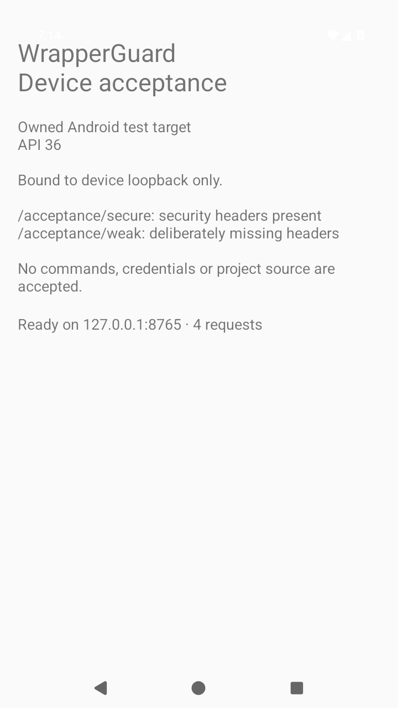

# Accepted Android emulator evidence: a97dcd1

[CI run 39480825850](https://github.com/Sal7one/NewWrapperGaurd/actions/runs/39480825850) passed on branch head `a97dcd19133e9b70b64bc88ae30835822712dbed`, testing PR merge source `9b48d88d2bd70deb6e8f39f43e4e1dc97f2344c2`. The merge's parent was independently checked against the branch head.

The real unmodified 720×1280 PNG was directly inspected by an agent. The owned API 36 activity, secure/weak route labels and ready state are visible, without a lockscreen, ANR, modal or blank frame. The foreground/UI gate passed on attempt one with eight owned nodes. SDK HTTP audit completed with zero secure-endpoint findings and three expected weak-endpoint findings.

- [Raw device evidence](evidence.json), [UI assertions](ui-check.json) and [UI tree](device-ui.xml) retain their original CI bytes.
- [Additive review](review.json) records the independent APK/PNG hash checks and accepted agent image inspection. Human visual review and physical-device testing were not performed.
- APK SHA-256: `f5c8b56ec352e3f106d8806674226415fcbfd90e41a8f5cb82ef208820491579`. The independently downloaded 9,909-byte owned fixture matched this hash. No APK binary is committed here.
- PNG SHA-256: `93aff5f7057f6f9c33ccbf1f49634ba05fc28aabf3b91344f8bafcace5fb297e`.

This is a separate owned Android HTTP acceptance fixture, not a mobile WrapperGuard plugin. The [earlier 76312ac record](../README.md) keeps its original source and artifact identities. A successful emulator run does not establish physical-phone or human accessibility acceptance.
